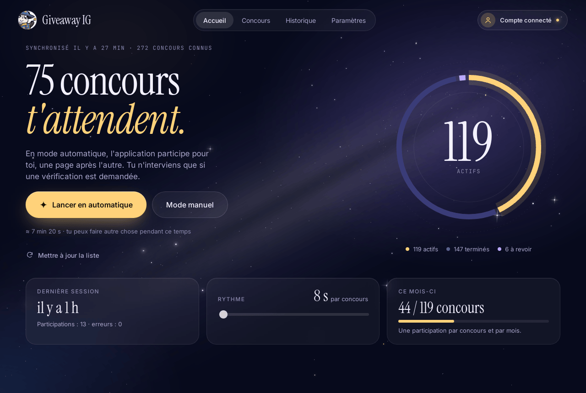
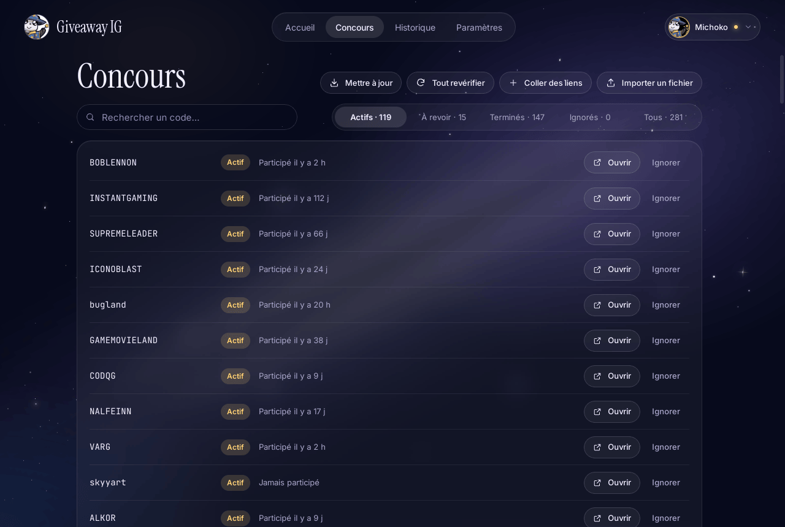
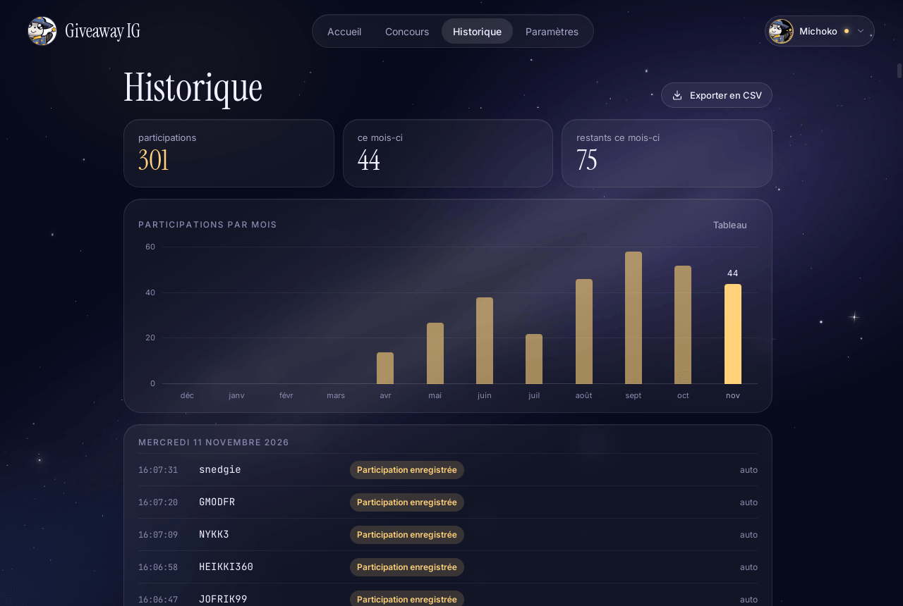
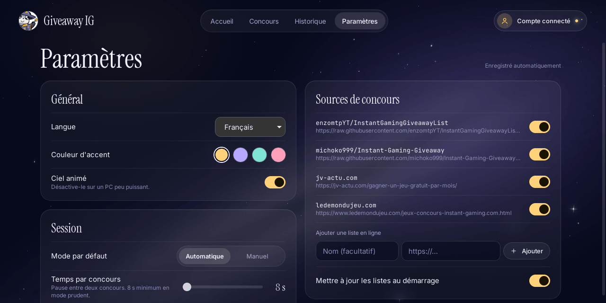

<div align="center">


# Giveaway IG

**Participe aux concours Instant Gaming sans y passer ta soirée.**

<a href="https://github.com/michoko999/Instant-Gaming-Giveaway/releases/latest"></a>


<a href="LICENSE"></a>

[English](README.md) · **Français** · [Español](README-ES.md) · [Deutsch](README-DE.md) · [Português](README-PT.md) · [Italiano](README-IT.md) · [Polski](README-PL.md)

<br />

<a href="https://github.com/michoko999/Instant-Gaming-Giveaway/releases/latest"></a>

<sub>Portable · sans installation · gratuit et open source</sub>

<br /><br />



</div>

<br />

Giveaway IG récupère les concours Instant Gaming encore ouverts, vérifie lesquels sont actifs et y participe pour toi, une page après l'autre, dans une interface en ciel étoilé. Tu te connectes une seule fois ; ensuite, un clic sur **Lancer en automatique** suffit chaque mois.

> [!NOTE]
> Projet open source, **non affilié à Instant Gaming**, sans lien d'affiliation ni de parrainage.

## ✨ Fonctionnalités

<table>
<tr>
<td width="50%" valign="top">

### 🤖 Mode automatique
Connecte-toi une fois dans la fenêtre Instant Gaming intégrée. L'application ouvre chaque concours et clique sur « Participer » pour toi, dans une fenêtre cachée : **Voir la page en direct** l'affiche quand tu veux.

</td>
<td width="50%" valign="top">

### 🖐️ Mode manuel
Les concours s'ouvrent un par un. Tu cliques sur « Participer » et l'application passe au suivant dès qu'elle le détecte. Pratique si tu préfères garder la main.

</td>
</tr>
<tr>
<td valign="top">

### 🛡️ Mode prudent
Activé par défaut : au moins 8 s entre deux concours, un nombre limité par session, et arrêt immédiat si le site affiche un avertissement. Les captchas te sont laissés, **jamais résolus ni contournés**.

</td>
<td valign="top">

### 📚 Des listes toujours à jour
Deux listes communautaires et deux sites qui partagent des concours (jv-actu.com, ledemondujeu.com) sont intégrés. Ajoute les tiennes : **Coller des liens**, un fichier, une liste en ligne ou n'importe quelle page web. Les concours terminés sont revérifiés chaque semaine et reviennent tout seuls.

</td>
</tr>
<tr>
<td valign="top">

### 📅 Ton mois d'un coup d'œil
Instant Gaming accepte une participation par concours et par mois : l'application passe ceux déjà faits, garde un historique avec un graphique par mois et l'exporte en CSV.

</td>
<td valign="top">

### 👥 Plusieurs comptes
Ajoute les comptes des personnes de ton foyer : chacun a sa connexion, son suivi du mois et son historique. La photo et le pseudo du compte actif s'affichent en haut à droite.

</td>
</tr>
<tr>
<td valign="top">

### 🚀 Mise à jour en un clic
Quand une nouvelle version sort, **Mettre à jour** la télécharge depuis les releases de ce dépôt, vérifie son empreinte SHA-256 et redémarre. Rien ne se fait sans ton clic.

</td>
<td valign="top">

### 💼 Portable, en 7 langues
Aucune installation : tout est rangé dans un dossier `GiveawayIG-data` à côté de l'exécutable. Français, English, Español, Deutsch, Português, Italiano, Polski.

</td>
</tr>
</table>

## 📸 Captures d'écran

<table>
<tr>
<td width="50%"></td>
<td width="50%"></td>
</tr>
<tr>
<td align="center"><sub><b>Concours</b> : tous les concours connus, leur statut et ta dernière participation</sub></td>
<td align="center"><sub><b>Historique</b> : participations par mois et journal complet</sub></td>
</tr>
<tr>
<td colspan="2"></td>
</tr>
<tr>
<td colspan="2" align="center"><sub><b>Paramètres</b> : langue, couleur d'accent, rythme des sessions, mode prudent, sources</sub></td>
</tr>
</table>

## 🚀 Bien démarrer

1. **Télécharge** `GiveawayIG.exe` (Windows) ou `GiveawayIG-x86_64.AppImage` (Linux) depuis la page [Releases](https://github.com/michoko999/Instant-Gaming-Giveaway/releases/latest).
2. **Range-le dans un dossier à toi**, par exemple `Documents\GiveawayIG`. Tes réglages seront enregistrés à côté.
3. **Lance-le.** Un petit assistant te guide :
   - **Connecter mon compte** : le site Instant Gaming s'ouvre dans l'application ; connecte-toi comme d'habitude (ton mot de passe se tape sur leur site, jamais dans l'application) ;
   - l'application récupère les listes et vérifie quels concours sont ouverts ;
   - choisis ton mode et ton rythme.
4. Clique sur **Lancer en automatique** (ou **Mode manuel**) et laisse faire. Reviens le mois prochain 🌙

Prérequis : Windows 10 ou 11 avec Microsoft Edge WebView2 (déjà présent sur Windows 11 et sur Windows 10 à jour). Sous Linux (x86_64), rends l'AppImage exécutable avec `chmod +x GiveawayIG-x86_64.AppImage`, puis lance-la : tes réglages sont aussi enregistrés à côté.

## ⚠️ Avant d'utiliser le mode automatique

Le règlement des concours interdit souvent les participations faites par des « robots ». Le mode automatique peut donc entraîner l'annulation de participations, voire une sanction sur ton compte Instant Gaming. **C'est à toi de décider** ; en cas de doute, utilise le mode manuel.

Le **mode prudent** (Paramètres → *Mode prudent (recommandé)*) réduit ce risque sans le supprimer :

- au moins 8 secondes entre deux concours, et un nombre limité de concours par session (40 par défaut) ;
- la session s'arrête tout de suite si le site affiche un avertissement ou demande plusieurs vérifications humaines, et après plusieurs erreurs d'affilée ;
- les concours déjà faits ce mois-ci ne sont pas rouverts ;
- la vérification des listes se fait sans ton compte, à un rythme modéré.

L'application ne cherche pas à se faire passer pour un humain : pas de faux mouvements de souris, pas de résolution de captcha.

## 🛡️ Antivirus et « Windows a protégé votre ordinateur »

La version 2 a été reconstruite pour ne plus ressembler à un logiciel malveillant :

- un vrai exécutable natif (Rust + Tauri) qui **ne se décompresse pas** dans un dossier temporaire comme l'ancienne version PyInstaller ;
- **aucune frappe clavier simulée** ni crochet clavier : les clics se font dans la fenêtre de l'application ;
- aucune écriture dans `%TEMP%`, aucun démarrage automatique avec Windows, aucune modification du système.

Tant que l'exécutable n'est pas signé (une demande de signature gratuite auprès de SignPath Foundation est prévue, voir la [politique de signature](docs/CODE_SIGNING_POLICY.md)), Windows SmartScreen peut afficher « Windows a protégé votre ordinateur » pour une nouvelle version. C'est un avertissement de réputation, pas une détection de virus : si le fichier vient de la page Releases et que son empreinte correspond, clique sur **Informations complémentaires** puis **Exécuter quand même**.

<details>
<summary><b>Vérifier que le fichier est authentique</b></summary>
<br />

Chaque release indique l'empreinte SHA-256 de l'exécutable et une **attestation de provenance** GitHub qui prouve qu'il a été compilé par GitHub Actions à partir du code public de ce dépôt :

```powershell
Get-FileHash .\GiveawayIG.exe -Algorithm SHA256
gh attestation verify .\GiveawayIG.exe --repo michoko999/Instant-Gaming-Giveaway
```

</details>

Si un antivirus signale quand même l'application, ouvre une [issue](https://github.com/michoko999/Instant-Gaming-Giveaway/issues) avec le nom de la détection pour qu'on la signale comme faux positif (Microsoft Defender : [portail de soumission](https://www.microsoft.com/wdsi/filesubmission)).

## 🔒 Vie privée

- Tu tapes ton mot de passe sur le site d'Instant Gaming, dans la fenêtre intégrée. L'application ne le voit pas et ne l'enregistre pas.
- La session (cookies) reste sur ton PC, dans `GiveawayIG-data\webview`. **Se déconnecter** dans les paramètres l'efface.
- Pas de télémétrie, pas de compte, pas de pub. L'application se connecte seulement à :

| Adresse | Pourquoi |
|:--|:--|
| `instant-gaming.com` | vérifier les concours et y participer |
| `gaming-cdn.com` | télécharger la photo de profil de ton compte |
| `raw.githubusercontent.com`, `jv-actu.com`, `ledemondujeu.com` | télécharger les listes de concours (chaque source peut être désactivée) |
| `api.github.com`, `github.com` | savoir si une nouvelle version existe et la télécharger (désactivable) |

## ❓ Questions fréquentes

<details>
<summary><b>Pourquoi je ne peux participer qu'une fois par mois ?</b></summary>
<br />
C'est la règle d'Instant Gaming : une participation par concours et par mois. L'application en tient compte et ne rouvre un concours que le mois suivant.
</details>

<details>
<summary><b>Comment ajouter des concours qui ne sont pas dans les listes ?</b></summary>
<br />
Dans <b>Concours</b>, clique sur <b>Coller des liens</b> et colle des liens ou des codes Instant Gaming (le texte autour est ignoré). Tu peux aussi importer un fichier ou ajouter une liste en ligne ou une page web dans <b>Paramètres → Sources de concours</b>. Pour en faire profiter tout le monde, ouvre une <a href="https://github.com/michoko999/Instant-Gaming-Giveaway/issues">issue</a> et ils seront ajoutés à la liste commune.
</details>

<details>
<summary><b>Je peux utiliser plusieurs comptes Instant Gaming ?</b></summary>
<br />
Oui : clique sur ton compte en haut à droite, puis sur <b>Ajouter un compte</b>, et connecte-toi avec dans la fenêtre qui s'ouvre. Chaque compte a sa propre connexion, son propre suivi du mois et son propre historique ; le menu en haut à droite permet de passer de l'un à l'autre. Le règlement des concours n'autorise souvent qu'une participation par personne : utilise un compte par personne.
</details>

<details>
<summary><b>Que se passe-t-il quand une vérification (captcha) apparaît ?</b></summary>
<br />
Le concours est mis de côté et la session continue. À la fin, le récapitulatif liste les concours à terminer à la main, avec un bouton pour ouvrir chaque page.
</details>

<details>
<summary><b>Où sont mes réglages ? Comment repartir de zéro ?</b></summary>
<br />
Dans le dossier <code>GiveawayIG-data</code>, à côté de <code>GiveawayIG.exe</code> (ou dans ton dossier utilisateur Windows si cet emplacement est en lecture seule). Pour déplacer l'application, déplace les deux ensemble. Pour repartir de zéro, ferme l'application et supprime ce dossier.
</details>

<details>
<summary><b>Comment mettre à jour ?</b></summary>
<br />
Quand une nouvelle version est publiée, un bandeau apparaît en haut de l'application : clique sur <b>Mettre à jour</b>. Tu peux aussi télécharger le nouveau <code>GiveawayIG.exe</code> à la main et remplacer l'ancien. Dans les deux cas, tes données restent en place.
</details>

<details>
<summary><b>Où est l'ancienne version en Python ?</b></summary>
<br />
Dans le dossier <a href="legacy/">legacy</a>. Elle n'est plus maintenue.
</details>

## 🤝 Contribuer

- **Concours** : envoie de nouveaux codes par une [issue](https://github.com/michoko999/Instant-Gaming-Giveaway/issues) ou une pull request sur [`List-Uncheck.csv`](List-Uncheck.csv). On n'en retire jamais aucun : un concours qui revient est repris tout seul.
- **Traductions** : les textes sont dans [`src/lib/i18n`](src/lib/i18n), un fichier par langue.
- **Bugs et idées** : les [issues](https://github.com/michoko999/Instant-Gaming-Giveaway/issues) sont les bienvenues.

## 🛠️ Compiler soi-même

Prérequis : [Node.js 22](https://nodejs.org), [Rust](https://rustup.rs) stable et, sous Windows, les outils de compilation C++ de Visual Studio ([prérequis Tauri](https://tauri.app/start/prerequisites/)).

```bash
npm ci
npm run tauri dev                 # lancer en développement
npx tauri build --no-bundle       # exécutable : src-tauri/target/release/giveaway-ig.exe
```

```bash
npm run check                                        # types TypeScript / Svelte
cargo test --manifest-path src-tauri/Cargo.toml      # tests du cœur en Rust
```

<details>
<summary><b>Organisation du projet</b></summary>

```
src/                 Interface (Svelte 5 + TypeScript)
  screens/           Écrans : assistant, accueil, session, récap, concours, historique, paramètres
  lib/               Ciel étoilé, anneau, graphique, état global, traductions (lib/i18n)
src-tauri/           Application Rust (Tauri 2)
  src/sources.rs     Listes : JSON communautaire, CSV, pages web, liens collés
  src/checker.rs     Vérification de l'état des concours
  src/automation.rs  Fenêtre Instant Gaming et script de participation
  src/session.rs     Sessions automatique et manuelle, mode prudent
  src/store.rs       Stockage local, historique, statistiques
  src/update.rs      Recherche et installation des mises à jour
scripts/             Préparation des icônes à partir de Magic.ico
docs/                Politique de signature, images du README
legacy/              Ancienne version Python (v1.3)
List-Uncheck.csv     Liste communautaire de concours (utilisée par l'application)
```

</details>

---

<div align="center">

<sub>[MIT](LICENSE) © 2023-2026 Michoko · Instant Gaming est une marque de son propriétaire ; ce projet n'y est pas affilié.</sub>

</div>
