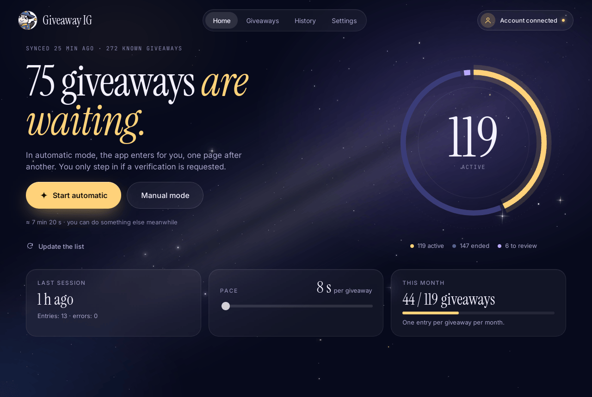
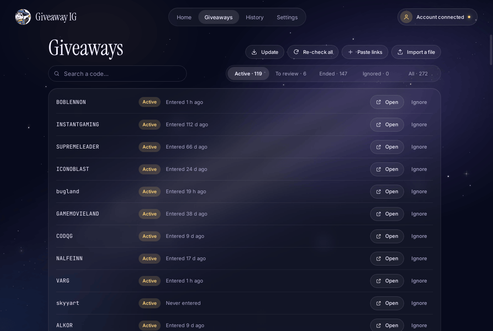
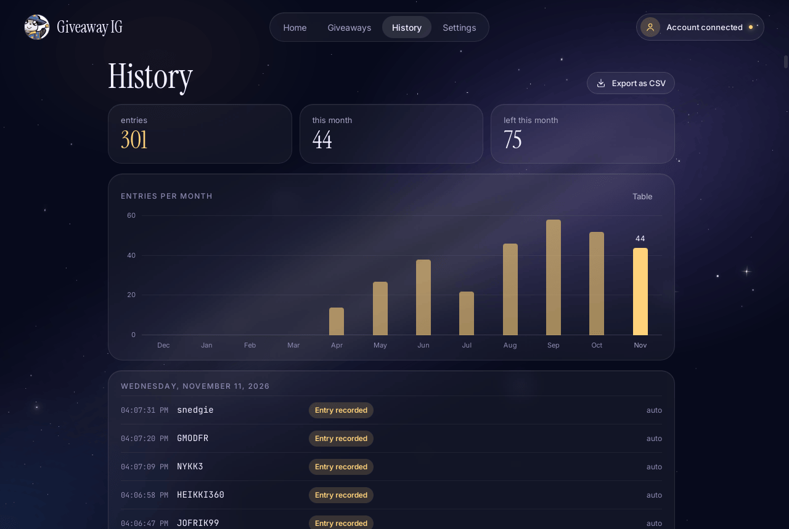
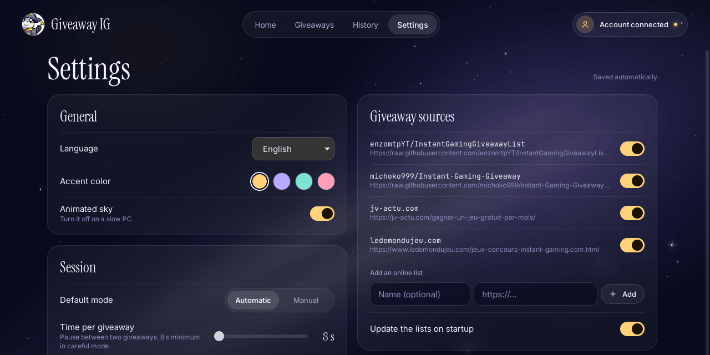

<div align="center">


# Giveaway IG

**Bierz udział w giveawayach Instant Gaming, nie tracąc na to całego wieczoru.**

<a href="https://github.com/michoko999/Instant-Gaming-Giveaway/releases/latest"></a>


<a href="LICENSE"></a>

[English](README.md) · [Français](README-FR.md) · [Español](README-ES.md) · [Deutsch](README-DE.md) · [Português](README-PT.md) · [Italiano](README-IT.md) · **Polski**

<br />

<a href="https://github.com/michoko999/Instant-Gaming-Giveaway/releases/latest"></a>

<sub>Przenośna · bez instalacji · darmowa i open source</sub>

<br /><br />



</div>

<br />

Giveaway IG zbiera giveawaye Instant Gaming, które są jeszcze otwarte, sprawdza, które są aktywne, i bierze w nich udział za ciebie, strona po stronie, w interfejsie przypominającym rozgwieżdżone niebo. Logujesz się tylko raz; potem co miesiąc wystarczy jedno kliknięcie w **Start automatyczny**.

> [!NOTE]
> Projekt open source, **niezwiązany z Instant Gaming**, bez linków afiliacyjnych ani polecających.

> [!TIP]
> Aplikacja jest dostępna po polsku: wybierz język w kreatorze przy pierwszym uruchomieniu albo w **Ustawieniach**. Zrzuty ekranu na tej stronie pokazują wersję angielską.

## ✨ Funkcje

<table>
<tr>
<td width="50%" valign="top">

### 🤖 Tryb automatyczny
Zaloguj się raz we wbudowanym oknie Instant Gaming. Aplikacja otwiera każdy giveaway i klika za ciebie „Weź udział”, w ukrytym oknie: **Zobacz stronę na żywo** pokazuje je, kiedy chcesz.

</td>
<td width="50%" valign="top">

### 🖐️ Tryb ręczny
Giveawaye otwierają się po kolei. Klikasz „Weź udział”, a aplikacja przechodzi dalej, gdy tylko to zauważy. Wygodne, jeśli wolisz mieć wszystko pod kontrolą.

</td>
</tr>
<tr>
<td valign="top">

### 🛡️ Tryb ostrożny
Domyślnie włączony: co najmniej 8 s między giveawayami, ograniczona liczba na sesję i natychmiastowe zatrzymanie, jeśli strona pokaże ostrzeżenie. Captche zostają dla ciebie: **nigdy nie są rozwiązywane ani omijane**.

</td>
<td valign="top">

### 📚 Zawsze aktualne listy
Wbudowane są dwie listy społeczności i dwie strony, które udostępniają giveawaye (jv-actu.com, ledemondujeu.com). Dodaj własne: **Wklej linki**, plik, listę online albo dowolną stronę internetową.

</td>
</tr>
<tr>
<td valign="top">

### 📅 Twój miesiąc w jednym spojrzeniu
Instant Gaming przyjmuje jedno zgłoszenie na giveaway w miesiącu: aplikacja pomija te już zrobione, prowadzi historię z wykresem miesięcznym i eksportuje ją do CSV.

</td>
<td valign="top">

### ♻️ Nic nie przepada
Zakończone giveawaye zostają na liście i są ponownie sprawdzane co tydzień. Jeśli któryś wróci, zostanie automatycznie przywrócony.

</td>
</tr>
<tr>
<td valign="top">

### 🚀 Aktualizacja jednym kliknięciem
Gdy pojawi się nowa wersja, **Aktualizuj** pobiera ją z wydań tego repozytorium, sprawdza jej odcisk SHA-256 i uruchamia aplikację ponownie. Nic nie dzieje się bez twojego kliknięcia.

</td>
<td valign="top">

### 💼 Przenośna, w 7 językach
Bez instalacji: wszystko jest zapisywane w folderze `GiveawayIG-data` obok pliku wykonywalnego. Français, English, Español, Deutsch, Português, Italiano, Polski.

</td>
</tr>
</table>

## 📸 Zrzuty ekranu

<table>
<tr>
<td width="50%"></td>
<td width="50%"></td>
</tr>
<tr>
<td align="center"><sub><b>Giveawaye</b>: wszystkie znane giveawaye, ich status i twój ostatni udział</sub></td>
<td align="center"><sub><b>Historia</b>: udziały w każdym miesiącu i pełny dziennik</sub></td>
</tr>
<tr>
<td colspan="2"></td>
</tr>
<tr>
<td colspan="2" align="center"><sub><b>Ustawienia</b>: język, kolor akcentu, tempo sesji, tryb ostrożny, źródła</sub></td>
</tr>
</table>

## 🚀 Pierwsze kroki

1. **Pobierz** `GiveawayIG.exe` ze strony [Releases](https://github.com/michoko999/Instant-Gaming-Giveaway/releases/latest).
2. **Umieść go we własnym folderze**, na przykład `Dokumenty\GiveawayIG`. Twoje ustawienia zostaną zapisane obok.
3. **Uruchom go.** Krótki kreator poprowadzi cię krok po kroku:
   - **Połącz moje konto**: strona Instant Gaming otwiera się w aplikacji; zaloguj się jak zwykle (hasło wpisujesz na ich stronie, nigdy w aplikacji);
   - aplikacja pobiera listy i sprawdza, które giveawaye są otwarte;
   - wybierz tryb i tempo.
4. Kliknij **Start automatyczny** (albo **Tryb ręczny**) i pozwól jej działać. Wróć w przyszłym miesiącu 🌙

Wymagania: Windows 10 lub 11 z Microsoft Edge WebView2 (wbudowany w Windows 11 i aktualny Windows 10).

## ⚠️ Zanim użyjesz trybu automatycznego

Regulaminy giveawayów często zakazują zgłoszeń wysyłanych przez „boty”. Tryb automatyczny może więc doprowadzić do unieważnienia zgłoszeń, a nawet do nałożenia kary na twoje konto Instant Gaming. **Decyzja należy do ciebie**; w razie wątpliwości używaj trybu ręcznego.

**Tryb ostrożny** (Ustawienia → *Tryb ostrożny (zalecany)*) zmniejsza to ryzyko, ale go nie usuwa:

- co najmniej 8 sekund między giveawayami i ograniczona liczba giveawayów na sesję (domyślnie 40);
- sesja zatrzymuje się od razu, gdy strona pokaże ostrzeżenie albo poprosi o kilka weryfikacji, a także po kilku błędach z rzędu;
- giveawaye, w których już wziąłeś udział w tym miesiącu, nie są ponownie otwierane;
- listy są sprawdzane bez twojego konta, w umiarkowanym tempie.

Aplikacja nie próbuje udawać człowieka: żadnych fałszywych ruchów myszą, żadnego rozwiązywania captchy.

## 🛡️ Antywirus i „System Windows ochronił ten komputer”

Wersja 2 została zbudowana od nowa, żeby nie przypominać złośliwego oprogramowania:

- prawdziwy natywny plik wykonywalny (Rust + Tauri), który **nie rozpakowuje się** do folderu tymczasowego jak dawna wersja z PyInstaller;
- **żadnych symulowanych naciśnięć klawiszy** ani przechwytywania klawiatury: kliknięcia odbywają się we własnym oknie aplikacji;
- żadnych zapisów w `%TEMP%`, żadnego autostartu z Windows, żadnych zmian w systemie.

Dopóki plik nie jest podpisany (planowany jest bezpłatny wniosek o podpis kodu do SignPath Foundation, zobacz [zasady podpisywania](docs/CODE_SIGNING_POLICY.md)), Windows SmartScreen może przy nowej wersji pokazać komunikat „System Windows ochronił ten komputer”. To ostrzeżenie o reputacji, a nie wykrycie wirusa: jeśli plik pochodzi ze strony Releases i jego odcisk się zgadza, kliknij **Więcej informacji**, a potem **Uruchom mimo to**.

<details>
<summary><b>Sprawdź, czy plik jest autentyczny</b></summary>
<br />

Każde wydanie podaje odcisk SHA-256 pliku wykonywalnego oraz **poświadczenie pochodzenia** GitHub, które dowodzi, że został zbudowany przez GitHub Actions z publicznego kodu tego repozytorium:

```powershell
Get-FileHash .\GiveawayIG.exe -Algorithm SHA256
gh attestation verify .\GiveawayIG.exe --repo michoko999/Instant-Gaming-Giveaway
```

</details>

Jeśli mimo to antywirus zgłasza aplikację, otwórz [issue](https://github.com/michoko999/Instant-Gaming-Giveaway/issues) z nazwą wykrycia, żeby można było zgłosić je jako fałszywy alarm (Microsoft Defender: [portal zgłoszeń](https://www.microsoft.com/wdsi/filesubmission)).

## 🔒 Prywatność

- Hasło wpisujesz na stronie Instant Gaming, we wbudowanym oknie. Aplikacja nigdy go nie widzi ani nie zapisuje.
- Sesja (ciasteczka) zostaje na twoim komputerze, w `GiveawayIG-data\webview`. **Wyloguj się** w ustawieniach ją usuwa.
- Bez telemetrii, bez konta, bez reklam. Aplikacja łączy się tylko z:

| Adres | Po co |
|:--|:--|
| `instant-gaming.com` | sprawdzanie giveawayów i udział w nich |
| `raw.githubusercontent.com`, `jv-actu.com`, `ledemondujeu.com` | pobieranie list giveawayów (każde źródło można wyłączyć) |
| `api.github.com`, `github.com` | sprawdzanie, czy jest nowa wersja, i jej pobieranie (można wyłączyć) |

## ❓ Najczęstsze pytania

<details>
<summary><b>Dlaczego mogę brać udział tylko raz w miesiącu?</b></summary>
<br />
Taka jest zasada Instant Gaming: jedno zgłoszenie na giveaway w miesiącu. Aplikacja to uwzględnia i ponownie otwiera giveaway dopiero w kolejnym miesiącu.
</details>

<details>
<summary><b>Jak dodać giveawaye, których nie ma na listach?</b></summary>
<br />
W zakładce <b>Giveawaye</b> kliknij <b>Wklej linki</b> i wklej linki albo kody Instant Gaming (tekst dookoła jest pomijany). Możesz też zaimportować plik albo dodać listę online lub stronę internetową w <b>Ustawienia → Źródła giveawayów</b>. Żeby podzielić się nimi ze wszystkimi, otwórz <a href="https://github.com/michoko999/Instant-Gaming-Giveaway/issues">issue</a>, a trafią na wspólną listę.
</details>

<details>
<summary><b>Co się dzieje, gdy pojawi się weryfikacja (captcha)?</b></summary>
<br />
Giveaway zostaje odłożony, a sesja trwa dalej. Na koniec podsumowanie pokazuje giveawaye do dokończenia ręcznie, z przyciskiem otwierającym każdą stronę.
</details>

<details>
<summary><b>Gdzie są moje ustawienia? Jak zacząć od nowa?</b></summary>
<br />
W folderze <code>GiveawayIG-data</code> obok <code>GiveawayIG.exe</code> (albo w twoim folderze użytkownika Windows, jeśli to miejsce jest tylko do odczytu). Żeby przenieść aplikację, przenieś oba razem. Żeby zacząć od zera, zamknij aplikację i usuń ten folder.
</details>

<details>
<summary><b>Jak zaktualizować?</b></summary>
<br />
Gdy zostanie opublikowana nowa wersja, u góry aplikacji pojawi się komunikat: kliknij <b>Aktualizuj</b>. Możesz też ręcznie pobrać nowy <code>GiveawayIG.exe</code> i zastąpić nim stary. W obu przypadkach twoje dane zostają na miejscu.
</details>

<details>
<summary><b>Gdzie jest stara wersja w Pythonie?</b></summary>
<br />
W folderze <a href="legacy/">legacy</a>. Nie jest już rozwijana.
</details>

## 🤝 Współpraca

- **Giveawaye**: wysyłaj nowe kody przez [issue](https://github.com/michoko999/Instant-Gaming-Giveaway/issues) albo pull request do [`List-Uncheck.csv`](List-Uncheck.csv). Żaden kod nie jest z niej usuwany: giveaway, który wróci, zostanie sam przywrócony.
- **Tłumaczenia**: teksty są w [`src/lib/i18n`](src/lib/i18n), jeden plik na język.
- **Błędy i pomysły**: [issues](https://github.com/michoko999/Instant-Gaming-Giveaway/issues) są mile widziane.

## 🛠️ Budowanie ze źródeł

Wymagania: [Node.js 22](https://nodejs.org), stabilny [Rust](https://rustup.rs), a w Windows narzędzia do kompilacji C++ z Visual Studio ([wymagania Tauri](https://tauri.app/start/prerequisites/)).

```bash
npm ci
npm run tauri dev                 # uruchomienie w trybie deweloperskim
npx tauri build --no-bundle       # plik wykonywalny: src-tauri/target/release/giveaway-ig.exe
```

```bash
npm run check                                        # typy TypeScript / Svelte
cargo test --manifest-path src-tauri/Cargo.toml      # testy rdzenia w Ruście
```

<details>
<summary><b>Struktura projektu</b></summary>

```
src/                 Interfejs (Svelte 5 + TypeScript)
  screens/           Ekrany: kreator, start, sesja, podsumowanie, giveawaye, historia, ustawienia
  lib/               Rozgwieżdżone niebo, pierścień, wykres, stan globalny, tłumaczenia (lib/i18n)
src-tauri/           Aplikacja w Ruście (Tauri 2)
  src/sources.rs     Listy: JSON społeczności, CSV, strony internetowe, wklejone linki
  src/checker.rs     Sprawdzanie statusu giveawayów
  src/automation.rs  Okno Instant Gaming i skrypt zgłoszeń
  src/session.rs     Sesje automatyczne i ręczne, tryb ostrożny
  src/store.rs       Lokalne przechowywanie, historia, statystyki
  src/update.rs      Wyszukiwanie i instalowanie aktualizacji
scripts/             Przygotowanie ikon z Magic.ico
docs/                Zasady podpisywania, obrazy do README
legacy/              Poprzednia wersja w Pythonie (v1.3)
List-Uncheck.csv     Lista giveawayów społeczności (używana przez aplikację)
```

</details>

---

<div align="center">

<sub>[MIT](LICENSE) © 2023-2026 Michoko · Instant Gaming jest znakiem towarowym swojego właściciela; ten projekt nie jest z nim związany.</sub>

</div>
